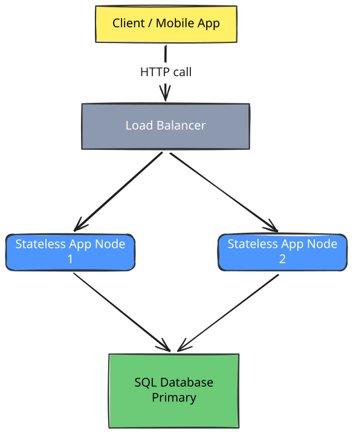
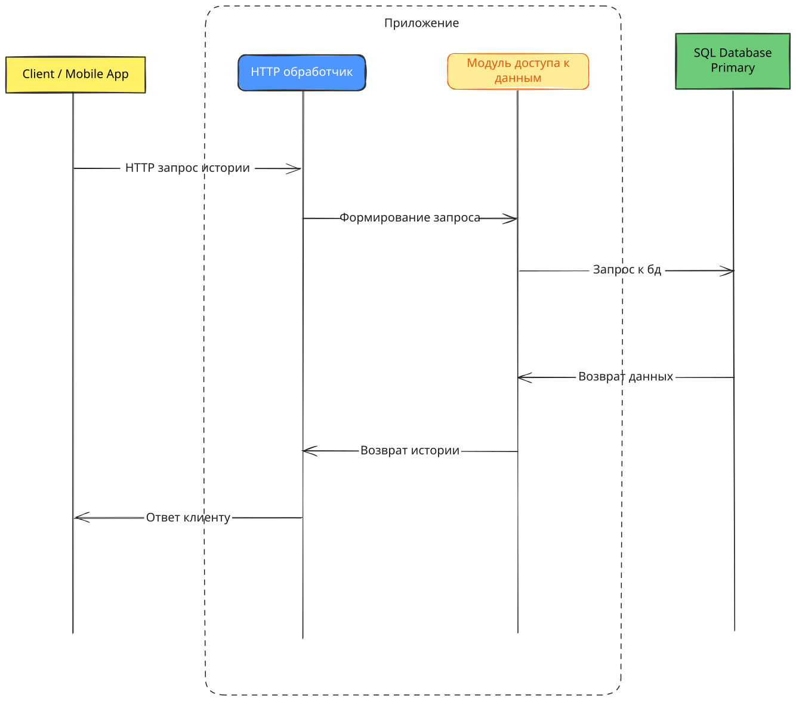

## Граница системы

Система предназначена для заказа такси по городу.

В системе есть два вида пользователей:
1. Пассажир, который хочет заказать поездку на такси.
2. Водитель, который принимает и выполняет поездку.

В зависимости от роли, пользователь может выполнять следующие действия:
1. Пассажир может создать заказ на поездку, отследить текущее состояние поездки, отследить активную поездку на карте, а также просмотреть историю своих поездок.
2. Водитель может принять заказ или отказаться от него.

Система позволяет создать заказ на поездку, подбирает свободного водителя и назначает его на заказ. Пассажир может получить текущий статус поездки, отслеживать её на карте в реальном времени и просматривать историю своих поездок.

Обработка платежей за поездки, уведомление пользователей, а также фактическое выполнение поездки находятся за границами сервиса.

Внешние участники:
1. Сервис оплаты - получает от системы такси запрос на списание или возврат денег за поездку. Он выполняет финансовую операцию и сообщает системе такси её результат.
2. Сервис уведомлений - получает от системы такси событие и получателя уведомления. Он доставляет сообщение указанному пользователю, без уведомления сервиса такси о результатах.

## Требования

- Создание поездок - 200_000 поездок в сутки, коэффициент пика х4.
- Чтение состояния - один запрос каждые 5 секунд для поездки в 15 минут, коэффициент пика х4.
- Просмотр истории - 60_000 открытий в сутки, коэффициент пика х2.

Цель p95 истории: < 50мс на 2_000_000 поездок.
Допустимая доля ошибок составляет 0,1 процента.

Объемы поездок:

Суточный объём рассчитывается как `размер записи × количество записей в секунду × 86 400`.
Возьмем размер 1 поездки равным 3 КБ.

| Данные | Размер записи | За сутки | За месяц (30 дней) | За год (365 дней) |
|---|---:|---:|---:|---:|---:|
| Поездки | 3 КиБ | 3 КиБ × 200_000 = ≈ 586 МиБ | ≈ 17,1 ГиБ | ≈ 206 ГиБ 

За год будет 73 миллиона поездок при среднем потоке = 200_000 × 365.

Для локального стенда выбраны следующие нагрузочные параметры:
- создание поездки: 5 созданий поездки в секунду
- чтение состояния: 20 чтений состояния в секунду
- просмотр истории: 5 чтений истории в секунду

Цель истории составляет p95 меньше 50 мс на двух миллионах поездок. Допустимая доля ошибок составляет 0,1 процента.

| Поток | Средняя нагрузка, запросов/с | Операция |
|---|---:|---|
| Создание поездок | 5  | Запись |
| Чтение состояния | 20 | Чтение |
| Просмотр истории | 5  | Чтение |
| **Всего** | **≈ 30** | Чтение и запись |

## Операции

| Поток | Расчёт запросов в секунду | Средняя нагрузка, запросов/с | Коэффициент пика | Пиковая нагрузка, запросов/с | Операция |
|---|---:|---:|---:|---:|---|
| Создание поездок | 200_000 / 86_400 | ≈ 2,32 | ×4 | ≈ 9,28 | Запись |
| Чтение состояния | 200_000 × 180 / 86 400 | ≈ 417 | ×4 | ≈ 1668 | Чтение |
| Просмотр истории | 60_000 / 86_400 | ≈ 0,7 | ×2 | ≈ 1,4 | Чтение |
| **Всего** | — | **≈ 420** | — | **≈ 1678** | Чтение и запись |

## Окружение



## Компоненты



## Модель данных

История поездок пассажира — массив объектов `Trip` (`Trip[]`). Модель поездки в ответе API:

```typescript
type TripStatus = 'searching' | 'accepted' | 'in_progress' | 'completed' | 'cancelled';

interface Trip {
  id: number;
  passengerId: number;
  driverId: number | null;
  pickupAddress: string;
  destinationAddress: string;
  createdAt: string;
  status: TripStatus;
  price: number;
}
```

Примечание: я бы также добавила поле `updatedAt: string` — дату и время последнего
изменения данных поездки. В текущей реализации этого поля нет.

Связь пассажира с поездками — один ко многим: у одного пассажира может быть
много поездок, каждая поездка относится к одному пассажиру. Поле `passengerId`
содержит идентификатор пассажира и используется для отбора его истории.

Для истории предлагается поддержать фильтрацию по статусу (`status`) и дате
создания (`createdAt`), например для просмотра поездок за последний месяц.
Также предлагается сортировка по полям `status` и `createdAt`.
В текущей реализации история сортируется только по `createdAt` от новых поездок
к старым; фильтрация по статусу и дате создания не реализована.

## Критический путь запроса истории

1. Приложение принимает HTTP запрос.
2. HTTP слой извлекает параметр passengerId из запроса, вызывает необходимый метод handlers
3. Handlers формирует SQL запрос и вызывает модуль доступа к данным.
4. Модуль доступа к данным получае соединение к бд из пула, отправляет ей SQL запрос.
5. База данных выполняет запрос и возвращает результат.
6. Соединение возвращается в пул.
7. Handlers получает сырые данные, преобразовывает их в модель DTO
8. HTTP слой сериализует DTO и отправляет ответ клиенту

## Итог

| Требование | Базовый результат | Решение | Повторный результат |
|---|---|---|---|
| p95 HTTP-запроса истории < 50 мс на 2 000 000 поездок при локальной нагрузке: 5 созданий, 20 чтений состояния и 5 запросов истории в секунду | p95 = 54,44 мс — цель не достигнута ([базовый отчёт](reports/baseline.md), [метрики](reports/baseline.json)) | Составной индекс на `trips (passenger_id, created_at DESC)` для отбора последних 20 поездок пассажира без полного сканирования таблицы и отдельной сортировки ([ADR](design/adr/010-history-index.md)) | p95 = 6,07 мс — цель достигнута в повторном локальном прогоне ([отчёт после индекса](reports/after-index.md), [метрики](reports/after-index.json)) |

В обоих прогонах доля HTTP-ошибок составила 0% при допустимых 0,1%;
пропущенных итераций не было (`dropped_iterations = 0`).

Тестирование проводилось на 2 млн записях, со следующими условиями:
- Количество запросов:
  - Создание поездки 5/сек
  - Чтение состояния 20/сек
  - Чтение истории 5/сек
Итого: 30 запросов в секунду.
- Ограничения ресурсов:
  - ядер у docker: 14
  - память docker: 33600495616 байт
  - лимиты app: 0,5 CPU и 512 МиБ памяти на контейнер
- Длительность сценариев:
  - warmup 10 секунд
  - основной 30 секунд

Однако данный опыт не подтверждает работоспособность системы под высокими нагрузками:
- количество записей фиксированное, поведение системы при дальнейшем росте не проверялось;
- длительность проверки составляет 30 секунд, поведение системы под длительной нагрузкой не проверялось;
- интенсивность запросов фиксированная, поведение системы при более интенсивной нагрузке не проверялось.

Данный опыт лишь подтверждает эффективность добавления составного индекса для таблицы trips для получения истории поездок пользователя: p95 снизился с 54,44 мс до 6,07 мс.

Следующим опытом я бы рассмотрела увеличение интенсивности запросов истории, сохранив объем данных, технические ресурсы, остальные потоки и длительность замера прежними. Это позволит определить, при какой интенсивности нарушается цель. Для определения конкретного ограничивающего ресурса необходимы дополнительные измерения загрузки CPU, использования памяти и времени ожидания соединений с базой данных.

Цель опыта - выяснить, при какой интенсивности запросов истории система сохраняет p95 < 50 мс, долю ошибок <= 0,1% и dropped_iterations = 0. Для поиска границы предлагаю увеличивать интенсивность запросов истории на порядок: сначала 50 запросов в секунду, потом 500 и т.п. Затем нужно будет уточнить границу между последней успешной и первой неуспешной ступенью с помощью промежуточных значений. На каждой ступени нужно фиксировать значения метрик: p95 истории, долю HTTP-ошибок и количество пропущенных итераций (dropped_iterations).

Ожидается превышение показателем p95 целевого времени.
